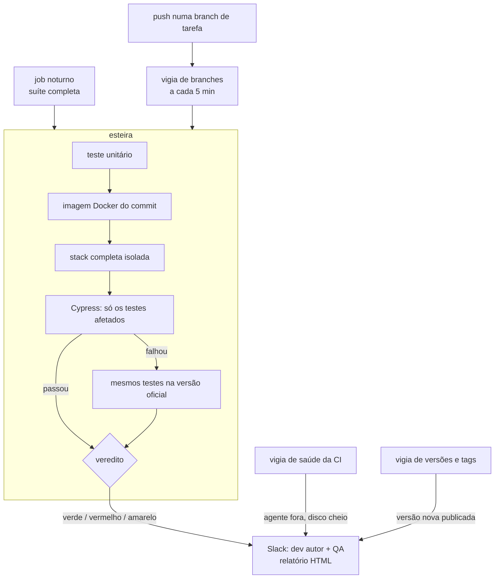
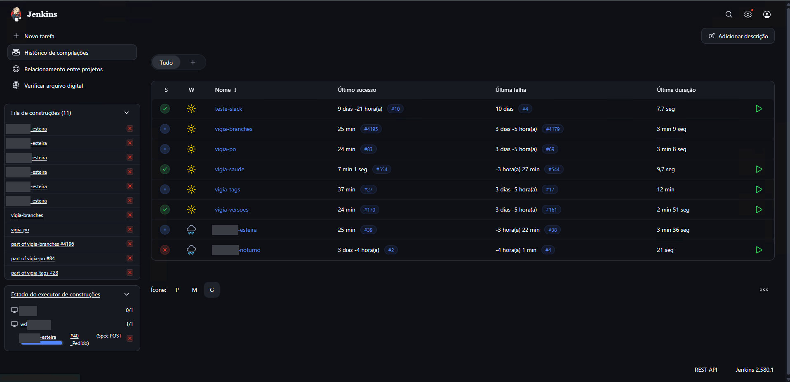
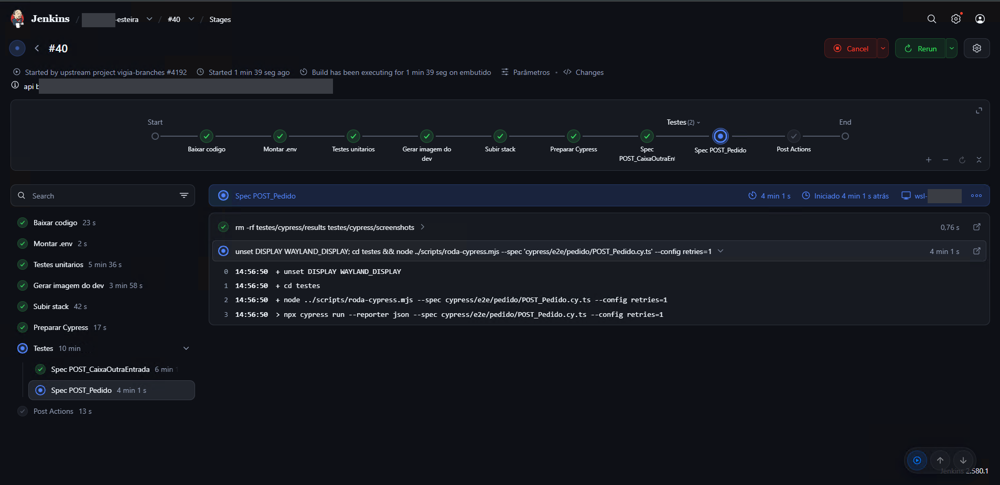
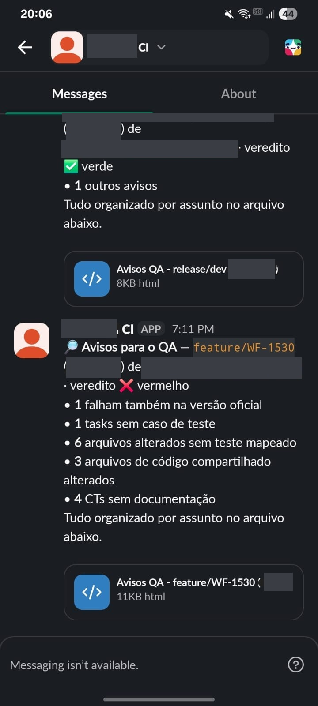
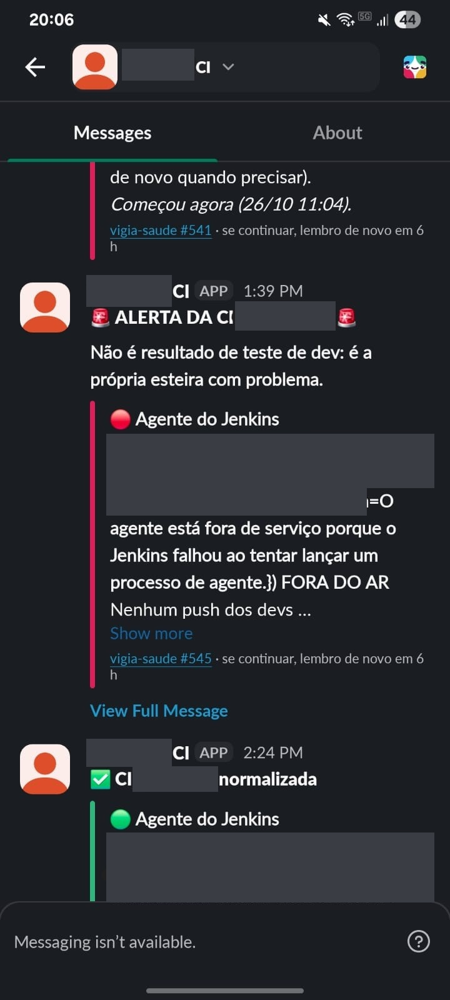
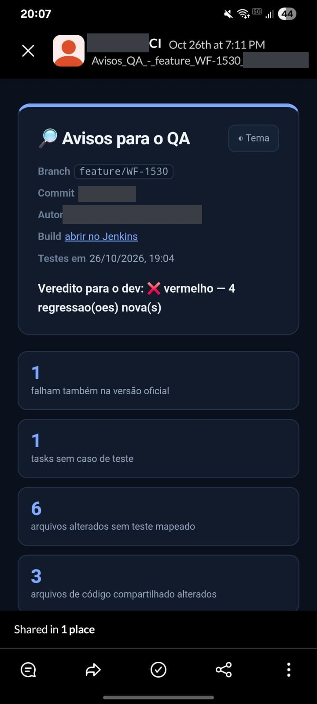
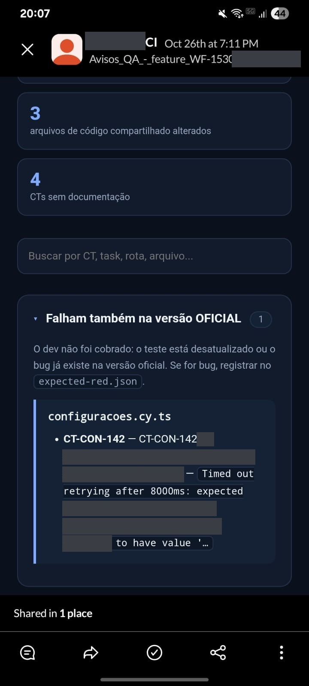

# Esteira de CI para testes E2E

**Cada commit testado antes de chegar ao QA, com veredito direto no Slack**

Estudo de caso de uma esteira que roda os testes afetados por cada push, compara o resultado com a versão oficial e só cobra do dev a falha que ele introduziu.

[O problema](#o-problema) · [A solução](#a-solução) · [Decisões técnicas](#decisões-técnicas) · [Resultados](#resultados) · [Como foi feito](#como-foi-feito) · [Evidências](#evidências)

> O código-fonte e os dados originais pertencem à empresa e não estão neste repositório. Nomes, endereços, dados e regras de negócio foram omitidos.

**Stack:** Jenkins (Pipeline as Code, Groovy) · Docker e Docker Compose · Cypress · Node.js · WSL2 (Ubuntu) · Slack API · PowerShell

## O problema

Num sistema web de gestão (front-end + API REST):

- Os testes E2E existiam, mas rodavam **à mão**. O bug de um dev só aparecia depois que a versão já tinha subido para o QA.
- Quando um teste falhava, ninguém sabia se a culpa era do commit novo ou de algo **que já estava quebrado** na versão oficial.
- O time não tinha servidor de CI: só um notebook disponível.

## A solução

Uma esteira que, a cada push numa branch de tarefa:

1. roda o **teste unitário** do repositório do dev e para ali se ele falhar;
2. gera uma **imagem Docker do commit**;
3. sobe a **stack completa** isolada: front, API, banco, storage e cache;
4. roda no Cypress **só os testes afetados** pelo que a branch mudou, com base num mapa de impacto;
5. se algo falha, roda **os mesmos testes na versão oficial** (a linha de base) e compara os resultados;
6. manda o **veredito no Slack** para o dev autor e para o QA dono dos testes, com um relatório HTML interativo.

## Decisões técnicas

| Decisão | Por quê |
|---|---|
| **Linha de base na versão oficial** | O dev só é cobrado pela falha que **ele** introduziu. Falha que já existia vira "herdada" e vai como aviso para o QA, não como reprovação. Foi isso que fez o time confiar no vermelho. |
| **Cache da linha de base** pela chave `versões oficiais + commit dos testes` | A stack oficial só roda de novo quando algo realmente mudou. |
| **Três cores** | Verde (pode mover a tarefa), vermelho (o commit quebrou algo) e amarelo (erro de ambiente, sem culpa do dev). Erro de infraestrutura nunca reprova um dev. |
| **Seleção de testes por mapa de impacto** | Uma tarefa que mexe num módulo roda os testes daquele módulo. A suíte completa fica para o job noturno. |
| **Teste unitário antes do E2E** | Falha barata primeiro: se o unitário quebra, não gasta minutos subindo a stack. |
| **Rollout em piloto** | A esteira começou avisando poucos devs e foi crescendo, uma pessoa por vez, conforme o resultado se mostrava confiável. |
| **Vigias agendados** em vez de webhooks | O servidor fica numa rede interna sem acesso de fora. Os jobs consultam o Git em intervalos curtos. |
| **CI monitorando a si mesma** | Um job no controlador (Windows) avisa quando o agente cai, quando o disco passa de 80% ou quando há três erros de ambiente seguidos. |
| **Scripts com teste** | A lógica de classificação, seleção e mensagens fica em módulos Node com `node:test`, e não em Groovy. É testável e roda localmente. |

## Resultados

**Menos regressões chegando ao QA.** Antes, o bug de um dev só aparecia depois que a versão subia para o QA. Com a esteira, a regressão é apontada no próprio push, para o dev que a introduziu, e corrigida antes de chegar à fase de testes.

- **8 jobs** Jenkins: esteira, noturno e vigias de branches, tags, versões, documentação e saúde
- **44 commits** em 11 dias, do primeiro build ao rollout em piloto
- **74 testes automatizados** nos scripts da própria esteira
- cerca de **14 minutos** do push à mensagem no Slack, incluindo o build da imagem e a stack completa

## Como foi feito

Usei o **Claude** (Anthropic) como ferramenta de implementação: ele escreveu o código a partir das minhas instruções. A engenharia por trás foi minha:

- identifiquei o problema e defini os requisitos;
- desenhei o fluxo da esteira e tomei as decisões técnicas descritas acima, como a linha de base, as três cores, a seleção por impacto e o rollout em piloto;
- conduzi a implementação etapa por etapa e acompanhei o rollout com o time;
- investiguei e resolvi os problemas de operação, como o incidente abaixo.

### Um incidente que virou melhoria

Um crash do Cypress dentro do WSL gerou um **arquivo de dump de 133 GB** no disco do Windows. O disco encheu, o sistema de arquivos do Linux entrou em modo somente leitura e a CI parou.

A investigação e a correção:

- encontrei o dump e recuperei o disco virtual com `e2fsck`;
- desliguei os core dumps no Linux com `kernel.core_pattern`;
- ativei o VHD esparso do WSL, para que o espaço apagado lá dentro volte ao Windows;
- passei a esteira a **limpar o que acumula a cada build**: imagens fora das versões oficiais, cache de build limitado e caches sem uso há 30 dias.

Resultado: o disco foi de **72 GB para 256 GB livres**, e o crescimento ficou limitado.

## Evidências

### Jenkins

A tela geral mostra os jobs de CI e monitoramento; a visão do build mostra a execução por etapas e os testes selecionados.

### Slack e relatório para QA e dev

O Slack envia um resumo do veredito e anexa um relatório HTML interativo. O relatório organiza as regressões novas, falhas já existentes na versão oficial e itens que precisam de atenção, com detalhes pesquisáveis para facilitar a análise do QA e do dev.

<table>
  <tr>
    <td align="center" valign="top" width="50%">
      <strong>Resultado dos testes</strong> 
      Resumo do veredito para QA e dev, com o relatório HTML interativo anexado.
    </td>
    <td align="center" valign="top" width="50%">
      <strong>Saúde da CI</strong> 
      Alertas no Slack quando o agente Jenkins fica indisponível e quando a esteira se normaliza.
    </td>
  </tr>
  <tr>
    <td align="center" valign="top" width="50%">
      
    </td>
    <td align="center" valign="top" width="50%">
      
    </td>
  </tr>
</table>

#### Relatório HTML interativo

O arquivo anexado à mensagem do Slack reúne o resultado da execução em uma página pesquisável. A primeira captura mostra o veredito e os indicadores da análise, como regressões novas, testes sem mapeamento e arquivos alterados. A segunda mostra falhas que também ocorrem na versão oficial, com contexto para o QA investigar sem atribuí-las automaticamente ao commit novo.

<table>
  <tr>
    <td align="center" width="50%">
      
       <strong>Resumo e indicadores</strong>
    </td>
    <td align="center" width="50%">
      
       <strong>Detalhe de falha herdada</strong>
    </td>
  </tr>
</table>
